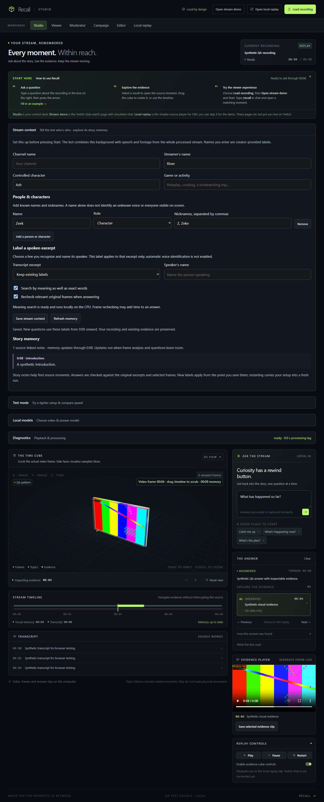

# Recall

**Ask a stream. Explore its memory. Check the evidence.**

A local Twitch companion for questions about coding, cooking, art, making,
gaming, conversations and events. Questions highlight matching moments in an
interactive 3D time cube; source excerpts and a separate evidence player let
you inspect the answer without seeking the broadcast source.



Recall is the new name of this project. Existing installations keep their
`tube-live` project folder, `.tubelive` saved data, and `tubelive` Python package
so recordings, model downloads, diagnostics and review boards remain available.
The public command is now `recall`; the older `tubelive` command and `!tube`
moderator commands remain compatible. Original Tube/Muse credits and historical
test recordings retain their original names.

Use `/recall <question>` in the stream demo, or `!recall <question>` in connected
Twitch chat. The older `/ask` and `!ask` commands still work as aliases.

## Start on Windows

Prerequisites: **uv**, **Node.js 22.12+**, **FFmpeg/FFprobe**, and **Ollama** with
the **local `qwen3.5:9b` model** installed. Do not select a cloud model. The setup
script installs a project-specific Python 3.12 environment and builds all web
assets locally. It downloads the speech model once; it sends no footage.

```powershell
.\Setup.ps1
.\Start.ps1
```

Open **http://127.0.0.1:8765/**. The included, clearly labelled **synthetic local
test clip** opens with memory automatically produced by local speech and vision
models. It is a provider demonstration, not a real-stream quality evaluation.
The older scripted GTA/Valorant fixtures remain available through `--bundle`
for deterministic tests; the interface labels those **SCRIPTED FIXTURE**.

## Which view should I use?

Use the **Workspace** navigation across the top. The new perspectives open in
separate tabs so reviewing a past moment does not interrupt source playback.

- **Studio** is the creator dashboard: load a recording, see processing progress,
  ask questions, and explore the transcript, cube and supporting footage.
- **Open stream demo** opens the viewer-facing Twitch-style simulation: the
  recording plays beside local chat, where you can type ordinary messages or
  `/recall` questions. Use this view to demonstrate the idea.
- **Open local replay** opens the simpler source player at `/broadcast`, intended
  for an OBS Browser Source. It feeds the same local processing pipeline. You do
  not need this extra view when the stream demo is already playing the source.
- **Moderator** finds surrounding broadcast context and keeps a human review
  queue with notes. Its questions stay off the shared broadcast.
- **Campaign** connects a sponsor brief and deliverables checklist to source
  moments. Confirm findings after watching the footage, then export review notes.
- **Editor** keeps a shortlist of story moments. Watch the setup, select moments
  for an edit, then open the clip editor to trim and download an MP4.

Only one source player should be open at a time. Neither replay view starts a
real Twitch broadcast by itself.

The new workspaces are local perspectives, not accounts with separate access
permissions. They use the same processed stream memory. See the
[perspective guide and research](docs/perspectives.md) for examples, saved-file
locations, and the limits of each view.

## Give the bot stream-wide context

In **Studio → Stream context**, enter the streamer, controlled character (when
relevant), activity, and known cast names. Save before starting the replay when
possible. The bot can now search earlier speech by meaning as well as words,
keep source-linked story notes, and inspect relevant original frames again.
“Summarize the entire stream so far” searches the whole available history.

Names supplied here are creator context; the app does not recognize voices or
faces automatically. You can label the speaker of a specific transcript excerpt.
Open **What the bot used** below an answer to inspect its actual source selection.
See [stream memory setup and verification](docs/stream-memory.md).

Visual answers also use the recording's original filename as background. In
**Stream context**, optionally set a clearer **Recording / stream title** and
**Description / background**. These help interpret a scene before speech is
available—for example, staff appearing to monitor a mission during spacecraft
coverage. Context does not establish their employer, job title or future actions.
Descriptions are entered locally; Recall does not automatically scrape a linked
video's description or the Twitch channel's metadata.

## Using the studio

1. **Ask:** Type a question about the recording in **Ask the stream** and press
   the arrow. Try “What happened in the last minute?” or ask about a visible
   object. Wait for the answer and its highlighted moments.
2. **Inspect:** Select an evidence card to open its source moment. Drag the
   cube to rotate it, scroll or use **+ / −** to zoom, and use the timeline to
   explore. Image width and height occupy two axes; time is the third. The
   selected plane decodes the video at the timeline position. The side faces
   are an approximation built from sampled image strips over time, not a
   reconstruction of physical 3D space.
3. **Use your own video:** Select **Load recording**, choose your file, then
   select **Open stream demo** and **Start local replay**. Keep that source page
   open. Wait for processing to reach the relevant part before asking about it
   in the demo chat or studio.

### Streaming-style demo

Choose **Open stream demo** from the studio after loading a recording. Close any
other local replay tab, then use **Start local replay** in the demo. It shows the
replayed video in a watch-page layout, with channel details below and a
**simulated, local** chat on the right. The optional scripted viewers carry
**DEMO** labels; they are example messages, not connected viewers. Ordinary
messages you type appear in chat and are not added to the content index.

1. Type `/recall What did he say about migratory birds?`, or another question about
   your recording. Speech questions search the transcript; other questions can
   retrieve spoken and visual evidence. Broad questions such as `/recall whats
   happening` use recent completed speech and visual observations directly.
   `/recall What is he saying?` uses recent speech. For specific questions, the
   local model interprets the intent and related search terms; when keyword
   search misses, it checks a bounded selection of available context.
2. The bot gives a short, natural-language answer with up to **three timestamp links**.
   The local model drafts the reply, then separately checks its claims against
   the cited speech and visual descriptions. A rejected paraphrase can fall back
   to the exact relevant spoken words; unsupported questions get a natural
   uncertainty message. Current-context questions prioritize the latest minute
   of processed memory and retrieve relevant older context. Specific searches
   can reach the entire processed history. The model receives a bounded selection,
   not every frame or every word at once. Questions never gain access to footage
   beyond the processing cutoff.
3. Click a link to open a separate moment tab. It plays up to **60 seconds**
   beginning at the match, bounded by the evidence available when you asked.
   A match near the processing edge may include earlier context and be shorter.
   This player does not seek or interrupt the source stream.
4. Adjust **Start** and **End**, then **Preview selection**, **Download MP4**, or
   **Share clip**. Sharing uses the browser's file-share dialog when available,
   with a download fallback when it cannot open. **Copy local link** copies a
   same-computer link, not a public URL. Links expire on replay/server restart;
   download the MP4 to share elsewhere.

### Test mode: compare local setups

Open **Test mode** near the top of the studio or stream demo.

1. Load a recording, then pause playback and let queued work finish.
2. Choose **Lighter · 4B + base** to use Qwen3.5 4B for video/answers and Whisper
   base on the CPU for speech. **Balanced · 9B + small** keeps the larger models.
   The lighter preset uses a brief description every ten seconds, 768-pixel
   frames, four CPU threads per model, and a three-frame live queue. Balanced
   keeps detailed descriptions every five seconds and complete processing.
   You can independently choose
   any installed compatible video model, a downloaded speech model, CPU threads,
   speech device, model CPU threads, 2/5/10-second sampling, and 480/720/768/960-pixel frames.
3. Keep **Natural conversation** selected. **Allow cautious predictions when asked**
   enables questions such as `/recall What might happen next?`. Predictions must be
   phrased as possibilities, grounded in already processed plans or actions.
   Direct source quotes and predictions-off are available for comparison.
4. Press **Start new test from beginning**. This clears the current memory and
   starts a new run while keeping the loaded video. In the stream demo, press
   **Start local replay** if the browser requires a playback click.
5. Try `/recall whats happening`, `/recall What did they say about the plan?`, and
   `/recall What might happen next?`. Open a timestamp link to inspect, trim,
   download or share the matching moment.
6. **Refresh results** shows peak lag, average speech/window and video/frame
   times, and the last answer time. **Download results** exports settings and
   timings without footage, transcript, questions or credentials. Keep the same
   recording and questions when comparing profiles. Wall time includes pauses;
   cold model loading can make the first request much slower.

Settings apply to the current server session. Test results persist locally
under `.tubelive/test-results.json` (last 20 runs). To change a model during a
test, start another test so its timing results do not mix configurations.
GPU speech is available only when compatible CUDA/cuDNN libraries are detected;
CPU speech leaves the GPU available for vision and answers.

Prepare optional lightweight models once during setup:

```powershell
ollama pull qwen3.5:4b
.venv\Scripts\python.exe -m tubelive.cli prepare --speech-model base
```

Models already downloaded are marked **ready**. Starting a test never downloads
a model or sends your footage to a hosted service. Smaller models trade accuracy
for speed; claim checking reduces errors but does not prove correctness.

The memory cube and supporting footage appear below the stream. Restarting
clears the replay's current memory and expires its moment links.

This simulation does not connect to Twitch. For a real Twitch replay, follow
the Twitch setup below and use `!recall` in Twitch chat.
The models analyze audio windows and sampled video frames as playback advances;
they do not analyze every frame. Questions can only use processed content.

The local replay page does not put you live on Twitch. For an OBS test, add
`http://127.0.0.1:8765/broadcast` as a Browser Source. Only one replay page can
own a session: close a replay tab and restart from the studio when switching
to OBS. Connecting Twitch chat is a separate setup described below.

Choose **Load recording** to copy a permitted local file into the app's local
cache (up to 8 GiB); allow enough free disk space for a copy. Then open the
replay. You can also open a recording by path without copying it:

```powershell
.\Start.ps1 -Video 'C:\Videos\my-recording.mp4'
```

The **studio** is the operator dashboard. The **broadcast view** at
**http://127.0.0.1:8765/broadcast** plays the source and feeds its clock and
sampled frames to local processing. Use it as an OBS Browser Source. Keep only
one broadcast page open for a source; a second source owner is rejected.
If OBS/browser autoplay is blocked, use OBS **Interact** to press Start.

The source is a **replay**, and must be labelled as such on Twitch. Memory starts
empty and grows as the source plays. The separate historical evidence player
does not change the source clock. Pause stops new input; work already captured
may finish. Unsupported seeks require restarting a fresh run.

## What works

- Local speech transcription and sampled visual descriptions.
- Find moments, inspect sequences, recap windows, and retrieve spoken plans.
- Timestamped evidence IDs, source labels, excerpts and bounded replay ranges.
- A Three.js cube with frame planes, search slabs, topic recurrence ribbons,
  orbit/zoom controls, an accessible flat timeline and transcript lane.
- Shared result selection and rotation, with streamer-controlled enable/disable.
- Twitch EventSub commands and public chat replies using an installed-app token.
- Local file import, session reset, memory export and status/lag reporting.
- Local demo chat with timestamp links, independent moment playback, trimming,
  MP4 download and browser sharing with a download fallback.
- Offline evidence/fixture queries without a model connection.

Visual ribbons represent **semantic recurrence**, not physical trajectories.
Five-second samples can miss brief events. Transcript text may contain speech
recognition errors. Generated visual descriptions remain model observations.
Source quotes should be checked against the actual recording.

## Twitch setup

Follow [the Twitch setup guide](docs/twitch-setup.md). Set credentials in the
launching PowerShell session, not in a committed file or chat:

```powershell
$env:TWITCH_CLIENT_ID = 'your-app-client-id'
$env:TWITCH_ACCESS_TOKEN = 'your-local-user-token'
.\Start.ps1 -Video 'C:\Videos\my-recording.mp4' -Twitch
```

Supported commands:

- `!recall Which setting changed before the preview worked?`
- `!recall @02:15 What happened in the last minute?`
- `!cube next`, `!cube prev`, `!cube left`, `!cube right`
- `!recall disable` / `!recall enable` for the broadcaster or moderators.

`enable` and `disable` are reserved moderator commands, not questions.

Chat answers and the cube are **public and shared**. There are no private
per-viewer dashboards, and no public ports or tunnels. The broadcaster account
also serves as the installed bot, so use a separate viewer account to test
questions; its own ordinary bot messages are ignored to prevent loops.

## Command line

After setup, activate `.venv\Scripts\Activate.ps1` to use `recall`, or replace
`recall` with `.venv\Scripts\python.exe -m tubelive.cli` in the examples below.

```powershell
recall doctor
recall prepare
recall ingest --video 'C:\Videos\my-recording.mp4' --out '.\recording-memory'
recall serve --bundle '.\recording-memory\memory.json' --video 'C:\Videos\my-recording.mp4' --local-ai
recall ask --bundle '.\recording-memory\memory.json' --q 'What was the stated next step?' --json
recall serve --video 'C:\Videos\my-recording.mp4' --replay --local-ai --twitch
```

`ingest` uses local vision and speech by default. `--srt path.srt` or
`--transcript-only` retains the baseline transcript/thumbnails import path;
these modes do not fabricate visual observations. Full-recording import is
different from incremental replay and is labelled recorded mode.

The app starts its own loopback Ollama service on port **11435** with
`OLLAMA_NO_CLOUD=1`; it reuses installed weights and does not rewrite your global
Ollama settings. Its managed service stops when the app exits. If another Recall instance occupies that port, close it first.

## Evidence and privacy boundary

Every answer and public memory response is bounded by the earliest of the
requested time, source playback position, and completed processing watermark.
Whole audio windows must finish before their facts are available. The same
filter applies to cube frames, citations and evidence ranges. Restarting clears
run-scoped selections and cancels stale work.

There is one controlled local model queue, one active question and at most one
waiting question. CPU speech recognition runs concurrently with GPU video
analysis. Each ingestion queue holds at most 16 pending jobs and refills from
already-played source footage. Delay alone never stops processing. Silence and
empty visual samples still advance progress; actual failures remain explicit.

Inference and storage remain local. Twitch commands and selected broadcast
outputs necessarily use Twitch's network. Ordinary chat is not indexed; viewer
profiles are not built. Tokens stay on the Python side. The HTTP service binds
to loopback and checks Host, Origin and a session token for changes. Source
text is data, never permission to execute actions, model tools, SQL or URLs.

App caches, copied uploads and explicit exports live under `.tubelive/`.
**Clear memory** resets generated session memory and generated frame assets;
it does not delete your original recording or model weights. Copied source
files and explicit exports remain on disk for you to remove when no longer
needed. Never commit `.tubelive`, `.env` or tokens.

## Verification and current limits

```powershell
.venv\Scripts\python.exe -m pytest -q
Push-Location viewer
npm.cmd run build
npm.cmd run test:ui
Pop-Location
```

See [the implementation verification record](docs/verification.md) and
[demo/submission guide](docs/demo-and-submission.md). The visual references are
documented in [inspiration](docs/inspiration.md). Real-footage checks have begun
with one supplied boat recording. The planned two-category evaluation, held-out
questions, live Twitch authentication/chat, and OBS playback/audio checks remain
pending; synthetic tests do not substitute for them.

A reproducible, visibly labelled synthetic test clip can be generated with:

```powershell
.venv\Scripts\python.exe scripts/make_smoke_media.py
```

It uses local graphics and Windows' offline speech voice. It is **not** one of
the two real recordings required by the acceptance plan.

Deferred: arbitrary broadcaster live capture, individual remote cubes,
automatic moderation/sanctions, reliable identity/physical tracking,
frame-accurate game statistics, automatic publishing, and public Extensions.

## Credits

Continues the user-provided Muse Tube Live baseline. Inspired by Amani Bobo's
[Tube](https://github.com/amanibobo/tube) and its query → retrieval → visual
evidence interaction; no source or assets from the unlicensed inspiration
archive were copied. Built with Codex. Preserve the main build session ID for
the hackathon submission.

## Playback and repeated scenery

### Debug playback and processing

Open **Diagnostics** above the video/cube in Studio or Stream demo. It separates
the source playback clock from processed memory, shows queued and active work,
frame/speech/answer timings, RAM availability and GPU use. **Download debug
report** saves the retained event history and current measurements as JSON.
Hardware is sampled about every two seconds, including GPU clocks, watts,
clock-limit flags, system CPU load and AC/battery state. Unsupported readings
are shown as unavailable. A low idle GPU clock alone is not proof of throttling.

Local logs live in `.tubelive/logs/diagnostics.jsonl` and two rotated files,
capped at approximately 6 MiB total. They record source play/pause/buffering,
tab visibility, browser errors, heartbeat failures, server controls and errors,
upload/clip activity, processing jobs and model timings. Logging begins when
the updated server and page are running; it cannot reconstruct earlier events.
Questions, transcripts, video frames, credentials and request bodies are excluded.
No logs are uploaded automatically. Raw Ollama service output remains separately
in `.tubelive/ollama.log` and is not included in the downloadable report.

A paused/disconnected player with an empty queue is different from a growing
processing backlog. `model_request_failed` identifies transport failures;
`model_output_rejected` distinguishes malformed output from an output limit.
Jobs now state `completed`, `cancelled` or `failed`; discarded work is not
reported as an inference failure. Brief vision uses one short sentence with a
64-token JSON budget (one 96-token retry on truncation). Detailed mode keeps
object/text extraction. Neither description mode guarantees exhaustive detection.

In **Analyze all sampled frames**, use **Retry processing** to retry failed work
with playback paused. In **Stay near live**, only the latest three pending
frames are retained; dropped samples and isolated failed windows become visible
coverage gaps. Speech keeps its separate worker and is not dropped by video
backpressure. Three consecutive failures in a lane pause processing for inspection.

**Resume from playhead** preserves earlier memory, marks skipped speech/video
analysis, and continues from the current source position. Forward source jumps
do this automatically. A backward seek creates a clean run to avoid exposing
previously processed future content. Missing analysis stays visible in memory,
answers, exports and test results; finishing a partial run is not labelled full
coverage. The source footage remains available for inspection.

Keep the replay page open: it supplies the source clock. The studio now opens
in a separate tab, and a source that stops reporting is labelled disconnected
after eight seconds. Pending work is suspended, while an already running job
can finish. Reopen the replay and press **Resume replay** to continue. A new
page can take control only after the old source is stale; a forward jump is
recorded as missing analysis. Processing lag and a missing source page are
different conditions.

Qwen receives one JPEG about every five seconds by default (configurable in Test mode) and describes its visible
contents. Faster-whisper handles completed ten-second audio windows. Questions
retrieve bounded transcript and visual evidence locally; Qwen selects supporting
IDs and drafts a checked natural reply. There is no model training.

Open **Local models** above Diagnostics to choose an installed Ollama model for
video and answers. Pause the replay and let frame analysis finish, choose a
vision-capable model, then click **Use model**. This applies to the current server
session, preserves existing memory and downloads nothing. Speech still uses
Whisper separately. Try the lighter Test mode preset for this laptop; the larger installed
models exceed its GPU memory budget and may be slower.

The cube grows with completed memory at a fixed time scale. Long recordings
produce a long volume. Drag to orbit, right-drag to pan, and scroll to zoom;
**Reset view** fits the whole memory. The overview retains up to 32 textures,
while frame scrubbing still uses the independent video decoder.

See [the investigation and optimization research](docs/local-performance.md)
for the measured failure, CPU/GPU scheduling, model choices and next experiments.

Audio is filtered to a 180–3800 Hz speech band before transcription. Voice
activity detection stays enabled with a 0.25 threshold, and low-confidence
segments are discarded. This recovered a previously missed bird reference in
the supplied noisy boat recording. It does not make automatic transcription
complete or exact: engine noise and quiet speech can still cause omissions or
incorrect words. Check the linked audio before quoting it. An empty transcript
now distinguishes processed audio with no recognized speech from pending work.

Exact consecutive image bytes reuse a cached visual description; changed images
still go through the model. Repeated identical text is referenced once in the
answer prompt, preserving occurrence IDs and timestamps. Similar scenery is not
discarded: a small bird or new object may matter. These conservative changes do
not promise a speedup for moving scenery. Adaptive scene sampling needs a
separate missed-event evaluation before becoming the default.
