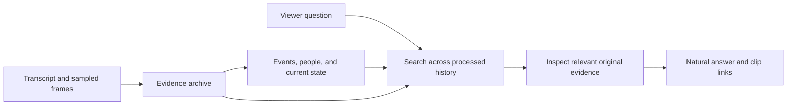

# Stream-wide context and streamer-aware answers

Research and pre-change code audit, October 31, 2026. The observations below describe the application **before** the memory upgrade. The subsequent implementation and its measured limits are documented in [Stream memory](stream-memory.md). Automatic voice identification remains deferred.

The immediate problem is incomplete context selection and missing identity/state management. The current implementation stores history, but it does not give Qwen a coherent account of that history. Model reasoning and transcription errors can also affect answers; this investigation does not measure their contribution to the user's specific bandaging example.

## What reaches Qwen today

| Operation | Actual input and limit |
| --- | --- |
| Frame observation | One sampled image per request, without neighboring images, transcript, or streamer profile. Brief mode requests one sentence of at most 18 words and omits the separate objects/text/topics fields. |
| “What's happening?” | Latest 60 seconds by default: up to three scene descriptions and six transcript segments. Natural mode may add five older keyword matches and the last three detected spoken plans, with a total cap of 16 records. |
| Specific historical question | Searches all eligible processed history unless the question requests a time window. Uses SQLite FTS5, stemming, synonyms, and model query interpretation/expansion. The answer still receives at most 16 selected records. |
| “Summarize the entire stream so far” | Currently takes the recap route, which defaults to the last 300 seconds. “Entire” and “so far” do not expand the range. This is a confirmed routing defect. |
| Answer generation | Text excerpts of transcripts and generated descriptions, at most 850 characters per record. It does not inspect the original images again. The Ollama context setting is 8,192 tokens. |
| Speaker/character context | Real transcription sets every speaker to `unknown`. Fixture entity structures exist, but the natural-answer payload has no separate speaker, entity roster, stream profile, or conversation history. Names can reach the model if they appear in selected excerpts. |
| Verification | A second request checks claims against selected excerpts. It can reject unsupported statements, but cannot recover information that retrieval omitted or reliably correct an inaccurate frame description. |

Source locations: [question selection](C:/Users/sujal/Documents/Codex/2026-10-28/new-chat/outputs/tube-live/src/tubelive/ask.py:685), [frame observation](C:/Users/sujal/Documents/Codex/2026-10-28/new-chat/outputs/tube-live/src/tubelive/localai.py:163), [answer prompt](C:/Users/sujal/Documents/Codex/2026-10-28/new-chat/outputs/tube-live/src/tubelive/localai.py:239), [transcription](C:/Users/sujal/Documents/Codex/2026-10-28/new-chat/outputs/tube-live/src/tubelive/media.py:84), [retrieval](C:/Users/sujal/Documents/Codex/2026-10-28/new-chat/outputs/tube-live/src/tubelive/retrieval.py:74).

The generic answer is consistent with these inputs: a short picture description can establish bandaging, while the character's name and earlier motivation are missing. Increasing the model size cannot supply missing stream facts. Removing the instruction against invented identities would create unsupported names.

## Reproduction without running a model

An in-process probe constructed 241 synthetic records spanning 20 minutes: a named character introduction at 2–5 seconds, ordinary speech and scenes every ten seconds, and bandaging observations near the end. A capture model recorded exactly what `answer_with_model` supplied; it made no inference requests.

| Question at 20:00 | Records supplied | Opening identity included? | Observation |
| --- | ---: | --- | --- |
| “whats happening” | 14 | No | Recent observations plus older lexical matches did not preserve the introduction. |
| “Summarize the entire stream so far” | 16 | No | Explicit trace: `context_window(900.00, 1200.00)`. |
| “Who is Ash?” | 15 | Yes | Direct name search found the introduction, then added fallback context. |

All three used the same complete synthetic memory. This proves a selection limitation, not the accuracy of Qwen on real footage. The earlier example was not replayed during this research.

## Research that applies

**Structured video memory.** VideoAgent stores temporal events and object-oriented memory, then retrieves evidence for a question. This supports separating observation, memory, and answering. It does not establish reliable identification of people in Twitch footage. [VideoAgent, ECCV 2024](https://arxiv.org/abs/2403.11481).

**Hierarchical memory with direct inspection.** Visual Agentic Memory retains searchable observations, organizes them at multiple time scales, and inspects candidates before answering. Its reported experiments use hosted Gemini models; the paper explicitly notes audio limitations and inference cost. Its architecture is a useful reference, but its results do not predict local Qwen performance. [VAM, 2026 preprint](https://arxiv.org/html/2605.16481v1).

**Changing facts and relationships.** Graphiti models entities, temporal relationships, and provenance back to original episodes. Those concepts fit plans that later change. Adopting the full framework would introduce another database and model-dependent extraction; a small evidence-linked schema in the existing application is a more contained first step. This is an engineering recommendation, not a benchmark result. [Graphiti documentation](https://github.com/getzep/graphiti).

**Who spoke when.** pyannote Community-1 supports local/offline speaker diarization after setup; WhisperX integrates diarization with transcription. Speaker labels still need a supported connection to a name. WhisperX explicitly documents overlapping-speech and diarization limitations. [Community-1 model card](https://huggingface.co/pyannote/speaker-diarization-community-1), [WhisperX limitations](https://github.com/m-bain/whisperX#limitations-).

**Streaming speaker continuity.** Diart uses rolling audio and incremental clustering for online diarization. It is a useful reference for keeping speaker IDs consistent across windows. Its documented dependency requirements need a separate compatibility test before integration; independent ten-second diarization calls must not assume that `SPEAKER_00` is always the same voice. [Diart](https://github.com/juanmc2005/diart).

**Semantic retrieval.** MiniLM-L6-v2 provides 384-dimensional text embeddings for semantic search. Its default input limit is 256 word pieces, so it should encode bounded utterance/event chunks rather than whole transcripts. Benchmark a CPU configuration against existing lexical search; this model neither interprets images nor determines identities. [Official model card](https://huggingface.co/sentence-transformers/all-MiniLM-L6-v2).

## Recommended design

Preserve original transcripts, sampled frames, source video, and timestamps. Add memory that makes those observations easier to find and interpret.

### 1. Stream profile and an editable cast

Provide optional setup fields for channel name, activity/game, streamer, controlled character, and known aliases. In the evidence viewer, let the creator assign or correct a speaker/character label. Store the basis for each assignment: creator-provided metadata, an explicit introduction, or a readable on-screen label.

Keep these concepts separate: broadcaster, microphone speaker, controlled avatar, another player/character, and someone merely mentioned. A name in a contact list does not identify the person on screen. Recognizing a voice cluster does not reveal its real-world name. If the connection is unknown, retain a neutral label.

For future owned recordings, a dedicated microphone track gives us a stronger source attribution than separating an already mixed soundtrack. OBS can record sources to separate tracks. Downloaded videos may only contain the mix; do not assume recoverable clean tracks. [OBS multitrack recording guide](https://obsproject.com/kb/multiple-audio-track-recording-guide).

Use a short, creator-confirmed name glossary as ASR hints and searchable aliases. Faster-whisper exposes `hotwords` and `initial_prompt`; hints can influence recognition, so preserve the original automated transcript and record corrections separately. Do not silently turn a guessed spelling into a verified name. [Faster-whisper implementation](https://github.com/SYSTRAN/faster-whisper/blob/master/faster_whisper/transcribe.py).

### 2. Event history and current state

Group completed speech and observations into short episodes, initially around 30–60 seconds or meaningful scene/topic changes. Extract compact, structured updates: participants, statements, actions, plans, changes, unresolved references, and supporting evidence IDs.

Keep an append-only event history. Maintain a compact current-state view and chapter summaries for retrieval, with links back to those events. A plan can become superseded, cancelled, or confirmed completed only with supporting evidence. An old intention should not remain the answer to “what's happening?” indefinitely. A summary is derived context, not independent proof.

Each derived item needs its run ID, source evidence IDs, source time range, time it became known, and any superseding item. Historical answers must use the state known at their cutoff. Learning a name or outcome later must not leak it into an earlier replay question. Creator-provided background must be visibly distinguished from facts learned during the stream.

### 3. Retrieve across the stream, then assemble a bounded answer context

Every question should have access to the archive. Reserve separate context budgets for the stream profile, relevant people, current state, recent speech/actions, and retrieved historical evidence. Budget tokens rather than relying only on a fixed record count.

For “what's happening?”, combine recent actions with earlier events needed to explain those actions. For “what did they say about migratory birds?”, search the full processed transcript and retrieve neighboring sentences around the matches. For “so far”, search chapter/event summaries across the full eligible range, then recover supporting originals.

Combine exact-name/keyword search with semantic search, time constraints, entity links, and adjacent context. Rank relevant changes above repeated scenery. Store repeated observations with their occurrence times; do not infer continuous presence or erase a brief change just because the setting looks similar.

Keep a small per-conversation question history for references such as “why did he do that?”. This should not become a global viewer profile or mix one viewer's conversational references with another's.

### 4. Reinspect visual evidence when the question needs it

Current answers inherit the information loss of short frame captions. After retrieval, send a small sequence of relevant original frames plus aligned dialogue to the vision model when identity, visual detail, or a transition remains unclear. Start with a bounded 2–4-frame inspection and measure cost. Extract more frames from the original recording only within the allowed past interval.

A multi-frame sequence provides more evidence of change than a single image, but cannot guarantee every action or person association was recognized. Keep independent visual observations alongside contextual interpretation so a mistaken transcript cannot silently rewrite what the picture showed.

### 5. Natural answers with explicit support

Illustrative only: suppose creator setup establishes that River plays Ash, earlier dialogue establishes a plan to meet Zeek, and the current footage shows Ash bandaging. A suitable reply is:

> Ash is bandaging up. Earlier, River said the plan was to meet Zeek about the heist.

The app would attach the current action and earlier dialogue as separate supporting links. It should add a cause such as “after the crash” only if that cause is established. If the meeting has since been cancelled, the updated state must replace the earlier plan. Predictions should remain clearly qualified and distinct from stated intentions.

## Implementation order and local cost

1. Correct whole-stream recap routing; expose the selected evidence times and IDs in a “What the bot used” debug view. Also log retrieval route, token budget, profile/state versions, missing coverage, and verification outcomes. Raw content traces should be explicit local diagnostics rather than silently included in shareable logs.
2. Add stream profile, editable cast, and evidence-linked event/state storage; include them in question selection. Start with existing Qwen and speech models.
3. Add semantic retrieval and question-directed visual inspection behind separate switches. Compare each against the same question set.
4. Evaluate speaker diarization on a short mixed-audio clip in an isolated environment, then integrate only if attribution improves enough to justify cost.

Keep the existing separate audio and vision workers. Schedule compact memory updates at lower priority, coalescing pending updates while retaining their source records. Keep one resident Qwen instance initially and reserve resources for viewer questions. Two autonomous LLM agents would add work and would not themselves solve missing history or name attribution.

The 30–60-second update cadence and 2–4-frame inspection are proposed starting points, not measured performance claims. Compare 4B versus 9B using identical retrieved evidence only after fixing context selection. The earlier successful processing run does not validate this additional workload.

## Acceptance evidence needed

Use a held-out recording with human-labelled identities and events, plus controlled synthetic histories for boundary tests. Evaluate retrieval separately from answer generation.

| Case | Required behavior |
| --- | --- |
| Name introduced near the start, question 20 minutes later | Correct supported character name and introduction citation. |
| Statement about migratory birds appears only early | Retrieve that statement despite later unrelated scenery and paraphrased wording. |
| A meeting is planned, then cancelled | Current answer reflects cancellation; earlier cutoff still reflects the original plan. |
| Streamer describes someone else's injury | Do not assign the injury to the streamer or controlled character. |
| New speaker, unclear introduction, overlapping voices | Preserve uncertainty; no invented identity. |
| Whole-stream recap | Include supported events from early, middle, and recent parts, not only the final five minutes. |
| Visual-only change omitted from a caption | Question-directed inspection can recover it from authorized earlier footage. |
| Future source, future alias, restart, or coverage hole | No cross-run or future leakage; missing analysis remains explicit. |

Record retrieval recall, name/role attribution accuracy, unsupported claims, citation correctness, answer latency, and ingestion lag. Require zero invented identities and future-evidence leaks on the labelled evaluation set; retain the existing supported/unsupported question gates. Passing synthetic routing checks is not evidence of real-world answer accuracy.
